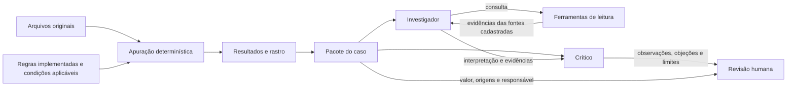

# Direção e roteiro da apresentação Lastro

Documento de trabalho para reunir as orientações de tom, narrativa, composição e transição da apresentação. A sequência cobre a capa, o problema, a explicação da solução, a arquitetura agêntica e a relação entre o fechamento de setembro e o uso em outubro. A abertura dos slides 0 a 9 preserva as decisões anteriores; os slides 10 a 31 são o desdobramento proposto a partir das novas orientações do usuário.

## Tom da apresentação

- Tratar a Tarvo como cliente e a apresentação como uma proposta real.
- Falar de forma direta, próxima e natural, como em uma conversa com o financeiro e o CFO.
- Começar apresentando a empresa e a organização atual do trabalho. Explicar as consequências depois que as três frentes estiverem compreensíveis.
- Usar frases curtas. Cada avanço visual acompanha uma ideia da fala.
- Depois da entrada da solução, apresentar o Lastro como gerenciador inteligente do fechamento financeiro, com uma descrição concreta do trabalho que ele organiza.
- Explicar a solução com calma, usando tópicos de fala e um tópico principal novo por avanço. Os bullets nas notas orientam a fala; a tela recebe somente o fragmento relevante.
- Anunciar a entrada na arquitetura agêntica e construir suas relações progressivamente, com responsabilidades nomeadas.
- Mostrar como o trabalho acontece: quem tem a informação, onde ela está e o esforço necessário para juntar tudo.
- Manter os detalhes técnicos e as evidências de apoio fora desta abertura.
- Usar as referências da Barte para estudar clareza, hierarquia e apresentação progressiva da informação. Desenvolver composição e identidade próprias para o Lastro.

## Roteiro de fala que orienta a sequência

> Essa é a Tarvo. Hoje, o financeiro dela se apoia em três frentes que não se conectam.
>
> De um lado, uma planilha com as taxas e condições de cada lojista. Do outro, relatórios dos parceiros e extratos bancários mostrando o que foi cobrado e movimentado. E, entre essas duas pontas, a Helena, que guarda o contexto dos acordos e das exceções que os arquivos não explicam.
>
> No fim do mês, o time precisa juntar essas três frentes para descobrir quanto pode faturar, o que precisa corrigir e quais valores continuam pendentes.
>
> Esse trabalho leva oito dias úteis, abre espaço para cobranças incorretas e deixa o fechamento dependente de quem conhece as regras.

O texto na tela acompanha a fala em fragmentos. O roteiro completo permanece nas notas de apresentação.

## Sequência dos slides

### Slide 0 — Capa

**Orientação do usuário:** a capa é o primeiro slide.

**Conteúdo proposto, sujeito a ajuste:**

- Título: **Lastro**.
- Subtítulo: **Fechamento financeiro da Tarvo**.
- Identificação discreta do time e do hackathon, quando definida.

Manter uma composição simples, com destaque para o nome do projeto. A capa antecede a explicação do problema.

### Slide 1 — Apresentação da Tarvo

**Elemento principal:** logo da Tarvo.

**Fala:** “Essa é a Tarvo.”

Dar espaço para a identificação da empresa, sem antecipar as três frentes ou suas consequências. Definir uma posição para a logo que possa ser preservada no slide seguinte.

**Asset pendente:** arquivo confirmado da logo da Tarvo. Reservar seu lugar na composição até que o material esteja disponível.

### Slide 2 — As três frentes

**Continuidade:** manter a logo e o contexto visual do slide anterior.

**Texto de apoio:** “Três frentes que não se conectam.”

**Fala:** “Hoje, o financeiro dela se apoia em três frentes que não se conectam.”

Preparar as três posições da composição. As frentes serão identificadas nos slides seguintes, uma por vez. O público deve conseguir acompanhar a construção do mesmo desenho.

### Slide 3 — Bolinha 1: a planilha

**Texto:** “Uma planilha com as taxas e condições de cada lojista.”

**Fala:** “De um lado, uma planilha com as taxas e condições de cada lojista.”

Revelar a primeira bolinha e sua legenda. Um símbolo simples de planilha pode apoiar a identificação, caso seja necessário. O destaque está no papel dessa fonte: registrar o que foi combinado com cada lojista.

### Slide 4 — Bolinha 2: os relatórios e extratos

**Texto:** “Relatórios dos parceiros e extratos bancários mostrando o que foi cobrado e movimentado.”

**Fala:** “Do outro, relatórios dos parceiros e extratos bancários mostrando o que foi cobrado e movimentado.”

Manter a primeira frente visível e revelar a segunda. Os dois lados passam a representar o combinado e o que aparece nos registros da operação. Preservar o espaço central para Helena.

### Slide 5 — Bolinha 3: Helena

**Texto principal:** “Entre essas duas pontas, a Helena.”

**Fala:** “E, entre essas duas pontas, a Helena, que guarda o contexto dos acordos e das exceções que os arquivos não explicam.”

Revelar a terceira bolinha e completar a composição triangular. Helena recebe destaque no centro, tornando visível seu papel de conectar e interpretar as informações.

**Direção de composição para conciliar o triângulo e Helena no centro:**

- Bolinhas 1 e 2 nos dois vértices superiores, com as respectivas legendas.
- Bolinha 3 no vértice inferior, como marcador da terceira frente.
- Nome ou representação de Helena no centro do triângulo, visualmente associado ao marcador 3. A legenda “Entre essas duas pontas, a Helena” acompanha esse elemento central.
- O marcador 3 e a representação central pertencem à mesma frente. A composição deve deixar essa relação clara.

Essa disposição é uma proposta de execução da orientação do usuário. Ajustar o desenho durante a produção para que a leitura continue imediata.

### Slide 6 — Junção: quanto pode faturar

**Fala de transição:** “No fim do mês, o time precisa juntar essas três frentes para descobrir…”

**Primeiro tópico:** “Quanto pode faturar.”

Mostrar o efeito de junção das três frentes, com linhas ou aproximação dos elementos em direção ao fechamento mensal. Manter Helena reconhecível na composição.

O efeito representa o esforço de consolidação do processo atual da Tarvo. A solução Lastro ainda não entra nesta cena.

### Slide 7 — Continuação: o que precisa corrigir

**Segundo tópico:** “O que precisa corrigir.”

Manter a composição anterior e o primeiro tópico. Acrescentar o segundo, com destaque temporário para a informação que acaba de entrar.

**Fala:** “…o que precisa corrigir…”

### Slide 8 — Continuação: quais valores continuam pendentes

**Terceiro tópico:** “Quais valores continuam pendentes.”

Preservar os dois tópicos anteriores e revelar o terceiro. A composição agora mostra as três perguntas que o time precisa responder para fechar o mês.

**Fala:** “…e quais valores continuam pendentes.”

**Decisão de sequência:** o trecho iniciado no slide 6 ocupa três slides consecutivos, um para cada tópico, conforme solicitado. Os tópicos se acumulam, mantendo a sensação de continuidade.

### Slide 9 — Final deste bloco: consequências

**Textos a apresentar:**

- “Trabalho leva oito dias úteis.”
- “Espaço para cobranças incorretas.”
- “Fechamento dependente de quem conhece as regras.”

**Fala:** “Esse trabalho leva oito dias úteis, abre espaço para cobranças incorretas e deixa o fechamento dependente de quem conhece as regras.”

Organizar as três consequências com hierarquia equivalente. Destacar **oito dias úteis** sem reduzir a legibilidade das outras duas. Simplificar os elementos anteriores para que o público concentre a atenção nas consequências.

Este é o encerramento da abertura sobre o problema. A entrada da proposta Lastro começa no slide 11, depois de um contexto curto no slide 10.

## Continuidade e estilo visual

- Construir a sequência como uma única explicação que evolui. Preservar posições, proporções e identidade dos elementos entre os slides.
- Nos slides 3 a 5, revelar uma frente por avanço. Nos slides 6 a 8, revelar uma pergunta por avanço.
- Aplicar a mesma lógica à solução: cada slide acrescenta um tópico principal à composição do bloco. Na mudança de assunto, conservar uma referência discreta do percurso anterior e abrir espaço para o novo desenho.
- Na arquitetura, manter a base de apuração e acrescentar pacote do caso, investigador, crítico e responsável humano. As setas precisam ter significado legível.
- Usar destaque para orientar a atenção ao elemento novo, mantendo os anteriores compreensíveis.
- Fazer a junção depois de apresentar as três frentes, para que o movimento tenha significado.
- As linhas do triângulo representam dependência e esforço de conexão. O desenho inicial deve conservar a leitura de fragmentação descrita na fala.
- Deixar as legendas legíveis à distância e evitar que a fala dependa de ler parágrafos projetados.
- Manter a logo da Tarvo associada ao contexto do cliente; o destaque de marca da capa pertence ao Lastro.

## Pendências para a produção

- [ ] Obter a logo confirmada da Tarvo.
- [ ] Confirmar título, subtítulo e identificação do time na capa.
- [ ] Definir se Helena será representada por nome, ícone ou imagem autorizada.
- [ ] Conferir a leitura do marcador 3 associado a Helena no centro.
- [ ] Ensaiar a fala com os avanços de slide e ajustar pausas.
- [ ] Ensaiar a demo com as saídas atualizadas de setembro, que já incorporam os ajustes tardios no commit `b43e80e`.
- [ ] Separar uma evidência real de orientação, erro e correção da IA no histórico de construção.
- [ ] Ensaiar a investigação assistida e conferir o estado real do modelo na versão apresentada.

## Continuação: solução em avanços progressivos

Os slides seguintes propõem a execução das novas orientações. Cada avanço inclui um tópico principal na tela, bullets de fala e a relação visual com o anterior. Os bullets não devem ser projetados juntos como um parágrafo. A numeração representa avanços da apresentação; não exige uma composição inteiramente diferente a cada slide.

### Slide 10 — Contexto curto: a regra depende da operação

**Tópico na tela:** “Cada operação precisa da regra certa.”

**Fala:**

- “Para juntar essas informações, a gente precisa saber qual regra vale para cada operação.”
- “Uma taxa depende do contrato e da data. Um estorno precisa respeitar a venda original.”

**Visual:** conservar as três frentes da abertura e aproximar um pequeno cartão de operação de um cartão de regra e vigência. Esse contexto prepara a necessidade do cruzamento; a explicação completa de setembro fica no bloco final.

### Slide 11 — Entrada da solução

**Tópico na tela:** “Lastro.”

**Fala:**

- “Foi esse processo que a gente organizou no Lastro.”

**Visual:** introduzir a marca própria do projeto, preservando discretamente as fontes que serão organizadas. Fazer uma pausa antes de avançar para a definição.

### Slide 12 — O que o Lastro é

**Definição na tela e na fala:**

> O Lastro é um gerenciador inteligente do fechamento financeiro da Tarvo.
>
> Ele reúne os arquivos e as regras da operação, apura as comissões, confere as cobranças e organiza as pendências para revisão do financeiro.

**Visual:** manter o nome Lastro e dar destaque a **gerenciador inteligente do fechamento financeiro**. A descrição do trabalho aparece em um bloco de apoio, com escala menor e leitura em três linhas. O slide responde o que o produto é; os avanços seguintes explicam seu funcionamento. Esta formulação substitui a definição anterior centrada nos verbos apurar, mostrar e encaminhar, conforme o novo pedido do usuário.

### Slide 13 — Receber os arquivos

**Novo tópico na tela:** “Recebe os arquivos como chegam.”

**Fala:**

- “A analista começa pelos arquivos que o financeiro já recebe.”
- “O Lastro lê o relatório da Orbe e seus ajustes, o anexo do e-mail da Ponte, a planilha de taxas e os extratos dos dois bancos, junto com o plano de contas.”

**Visual:** cartões simples de arquivo convergem para uma área de entrada. Nomear as fontes. As conexões representam leitura de arquivos; o relatório da Orbe não deve parecer uma API integrada.

### Slide 14 — Relacionar operação, lojista e condição

**Novo tópico na tela:** “Liga cada operação ao lojista e à condição aplicável.”

**Fala:**

- “Depois, ele relaciona os identificadores da operação ao lojista e à condição comercial válida naquela data.”
- “As orientações do financeiro ficam registradas com suas fontes. O que ainda depende de confirmação continua como hipótese ou pendência.”

**Visual:** os arquivos permanecem à esquerda. Acrescentar cartões de **lojista**, **contrato e vigência** e **orientação do financeiro** ao lado de uma operação. Esta etapa explica como os dados se encontram, antes de mostrar os cálculos.

**Nota técnica:** as regras de cálculo estão implementadas no motor; registrar uma conversa no catálogo não altera automaticamente uma regra aprovada.

### Slide 15 — Apurar o checkout

**Novo tópico na tela:** “Checkout: calcula a comissão e compara as taxas.”

**Fala:**

- “No checkout, ele calcula a comissão pela condição contratada e compara com a taxa que foi aplicada.”
- “Estornos e reversões entram com o tratamento da operação original. A soma é feita a partir dos valores de cada linha.”

**Visual:** acrescentar o primeiro bloco de apuração, com uma operação, a taxa contratada e a taxa aplicada. Identificar separadamente **comissão** e **divergência**. A diferença entre elas precisa continuar legível.

### Slide 16 — Apurar as remessas

**Novo tópico na tela:** “Remessas: apura a participação da Tarvo no spread.”

**Fala:**

- “Nas remessas, ele calcula os 50% de participação da Tarvo sobre o spread realizado elegível.”
- “Também verifica duplicidades e diferenças em relação ao contrato. Os spreads negativos contestados ficam fora da comissão e seguem como pendência.”

**Visual:** manter o checkout e acrescentar a segunda frente de apuração. Uma operação repetida converge para uma única contribuição, com a referência original preservada. Distinguir a participação da Tarvo do valor integral de uma divergência de spread.

### Slide 17 — Classificar os movimentos bancários

**Novo tópico na tela:** “Bancos: classifica cada movimento no plano de contas.”

**Fala:**

- “Nos extratos, ele propõe a classificação de cada movimento no plano de contas.”
- “Um recebimento pode baixar uma comissão de agosto. Uma transferência pode continuar em trânsito no fim de setembro. O tratamento depende da natureza do movimento.”

**Visual:** acrescentar a terceira frente, ligando uma linha de extrato à conta proposta e à justificativa. Mostrar uma transferência em trânsito como exemplo; o destino ERP representa a classificação preparada, sem simular lançamento realizado no Fênix.

### Slide 18 — Preparar as entregas do fechamento

**Novo tópico na tela:** “Reúne os resultados do fechamento.”

**Fala:**

- “As três frentes alimentam as entregas pedidas no desafio.”
- “São seis arquivos: comissões, divergências, notas a emitir, lançamentos classificados, pendências e rastro.”
- “As notas ficam preparadas para revisão. A emissão fiscal depende da continuidade da operação.”

**Visual:** fazer as frentes convergirem para um conjunto de seis cartões, com nomes curtos e hierarquia equivalente. Revelar o conjunto neste avanço, sem abrir seis tabelas ao mesmo tempo.

### Slide 19 — Conferir a origem de cada valor

**Novo tópico na tela:** “Cada valor aponta para as linhas que o compõem.”

**Fala:**

- “Ao abrir um valor, a analista encontra as operações que formam aquele total, a regra aplicada e a referência da fonte.”
- “A soma dessas contribuições precisa conferir com o resultado apresentado.”

**Visual:** ampliar um cartão de resultado do slide anterior e ligá-lo a suas linhas de origem. Usar o mesmo valor e a mesma referência ao passar para a demo.

### Slide 20 — Demo: do valor à operação

**Tópico na tela:** “Uma diferença que pode ser conferida.”

**Fala:**

- “Vamos abrir a Rota Global para conferir esse caminho.”
- “Aqui estão o total, os componentes e a taxa usada em cada operação.”

**O que mostrar:** abrir a composição do caso Rota, selecionar uma operação e mostrar bruto, taxa contratada, taxa aplicada, diferença monetária e origem. Voltar ao total para concluir a relação entre soma e resultado.

**Referência atualizada:** o [pacote Rota em `b43e80e`](https://github.com/DavidDeodato/Hackathon_barte/blob/b43e80e521646cc46b09e8f2c920fb035c20644d/saida/rota_packet.json), execução `close-2068e24a102ebea3`, mantém diferenças positivas de R$ 1.644,72, abatimento de R$ 98,44 e líquido de R$ 1.546,28 preparado para revisão. A soma dos 87 componentes foi conferida nas saídas publicadas. No slide de desenvolvimento, o exemplo é uma representação nativa desses dados; o percurso efetivo na interface ainda deve ser ensaiado. O valor preparado não comprova envio ou recuperação.

## Entrada explícita na arquitetura agêntica

### Slide 21 — Mudar a pergunta: como a investigação funciona

**Título na tela:** “Arquitetura agêntica.”

**Tópico de apoio:** “Como o Lastro investiga um caso.”

**Fala:**

- “Até aqui, vimos como o Lastro apura os valores e mostra suas origens.”
- “Agora vamos entrar na arquitetura agêntica: como esses resultados viram um caso para investigação e revisão.”

**Visual:** reduzir o percurso anterior a uma base reconhecível, rotulada **apuração e rastro**. Acima ou à direita, reservar a faixa **investigação assistida**. Construir o novo fluxo sobre essa base nos próximos quatro avanços. O título anuncia a mudança de assunto.

### Slide 22 — Formar o pacote do caso

**Novo tópico na tela:** “O caso reúne o valor e o contexto da decisão.”

**Fala:**

- “A partir da apuração, o sistema monta um pacote do caso.”
- “Ele reúne valor, composição, natureza da ação, fontes, responsável e o que falta para encerrar a pendência.”

**Visual:** revelar o cartão **pacote do caso**, ligado à base de apuração. Mostrar três grupos visuais: **valor e origens**, **regras e contexto**, **ação e responsável**. Esse cartão é um artefato de dados, sem representação de agente.

### Slide 23 — Agente investigador

**Novo tópico na tela:** “O investigador consulta as fontes do caso.”

**Fala:**

- “O investigador recebe esse pacote e usa ferramentas para localizar as regras e as referências que ajudam a interpretar o caso.”
- “Ele pode buscar regras, consultar uma referência, ler uma fonte cadastrada e verificar pendências. A interpretação vem acompanhada das evidências consultadas.”

**Visual:** revelar **investigador** à direita do pacote. Abaixo, acrescentar uma pequena área de ferramentas ligada às fontes. Rotular a ida como **consulta** e a volta como **evidências**. A saída do investigador recebe o nome **interpretação e fontes citadas**.

**Nota técnica:** mostrar os nomes de ferramenta apenas se ajudarem na demo: `search_rules`, `lookup_reference`, `read_source` e `review_pending`. Acesso às fontes é limitado ao catálogo e aos limites da execução.

### Slide 24 — Agente crítico

**Novo tópico na tela:** “O crítico confronta a interpretação com as evidências recebidas.”

**Fala:**

- “Depois, outro papel examina a interpretação: o crítico.”
- “Ele recebe o pacote, a conclusão do investigador e as evidências recuperadas. Procura contradições, generalizações e decisões sem sustentação suficiente.”

**Visual:** revelar **crítico** depois do investigador. Desenhar uma ligação do pacote ao crítico e outra do investigador ao crítico, rotulada **interpretação + evidências**. Acrescentar na saída **observações, objeções e limites**.

**Limite da associação:** o crítico trabalha com o material recebido e não faz uma nova busca de ferramentas nesta implementação. Dois papéis não demonstram, por si, correção semântica ou benefício adicional medido.

### Slide 25 — Encaminhar para decisão humana

**Novo tópico na tela:** “A revisão volta para quem precisa decidir.”

**Fala:**

- “O resultado dessa investigação volta para a analista com as fontes, as observações e o que ainda precisa de confirmação.”
- “Os valores continuam vinculados à apuração. Helena e o Comercial mantêm as decisões que lhes cabem.”

**Visual:** completar o percurso com **revisão humana**, acompanhada do responsável do caso. A base financeira continua visível. As conexões terminam em revisão e encaminhamento; a aprovação ou o envio só podem aparecer quando houver registro correspondente.

**Estado da entrega:** a revisão assistida é experimental, com qualidade semântica ainda não validada e estado `needs_evidence`. Explicar esse limite junto da demonstração, com linguagem simples: “O parecer ajuda a revisar; ainda precisa ser conferido.”

### Mapa de relações para orientar a composição

Este esquema é referência de produção. Nos slides 21 a 25, revelar um componente por avanço e conservar os anteriores em segundo plano. O grafo completo não deve disputar atenção com a fala desde o início.

**Referência visual e adaptação própria:** o [fluxo do case Comp](https://mktbarte.github.io/cases/case-comp.html) ajuda a separar fontes, contexto e ação. A [esteira do case Sallve](https://mktbarte.github.io/cases/case-sallve.html) ajuda a revelar etapas e intervenção humana. A composição do Lastro usa seus próprios cartões, cores e tipografia; as linhas representam somente as relações descritas aqui. Ver [referências](referencias.md).

### Slide 26 — Demo: abrir a revisão do caso

**Novo tópico na tela:** “A analista acompanha a revisão na mesa do caso.”

**Fala:**

- “Na interface, ela parte da pendência e abre a mesa do caso.”
- “Ali pode conferir o pacote e, quando solicitar a revisão assistida, acompanhar as fontes consultadas e o parecer de cada papel.”

**O que mostrar:** abrir a mesa pela pendência, localizar valor e responsável, identificar o pacote de origem e mostrar uma execução real da investigação e da crítica. Abrir uma evidência e uma observação relevante. Encerrar apontando a confirmação que continua necessária.

**Preparação:** ensaiar esse caminho na versão utilizada. Identificar execução real, consulta sem IA ou replay de teste de acordo com o modo exibido. Se o modelo falhar, mostrar o estado correspondente e continuar a conferência pelo pacote disponível, sem apresentar a falha como revisão concluída.

### Slide 27 — Quando a informação ainda falta

**Novo tópico na tela:** “A falta de contrato vira uma pendência identificada.”

**Fala:**

- “Na Atlas, as operações estão identificadas, mas a condição comercial da taxa ainda depende de confirmação.”
- “Por isso, a comissão fica sem quantificação. As operações permanecem vinculadas ao caso para serem tratadas quando a condição for confirmada.”

**Visual:** mostrar um cartão de pendência com origem, responsável e condição para faturar. Separar volume movimentado e comissão desconhecida. O bloqueio se refere ao faturamento da taxa; a resposta posterior do financeiro confirma que os repasses dos recursos do lojista continuam.

## Alcance atual e continuidade: setembro é o fechamento a entregar

### Slide 28 — O que setembro representa no case

**Novo tópico na tela:** “Setembro é o fechamento que a Tarvo precisa entregar.”

**Fala:**

- “No desafio, setembro é a competência que precisamos fechar: apurar as comissões, conferir as cobranças, preparar as notas e classificar os movimentos dos dois bancos.”
- “Esse mês recebe efeitos de operações anteriores e deixa obrigações que continuam em outubro.”

**Visual:** colocar **fechamento de setembro** no centro de uma linha temporal. À esquerda, um estorno de venda de agosto afeta setembro. À direita, uma transferência iniciada em 30 de setembro continua em trânsito até a entrada de outubro. Revelar uma associação por fala, conservando a competência central.

**Leitura do requisito:** setembro define a entrega concreta e a base de avaliação dos números. O tratamento entre competências faz parte do problema operacional; restringir a explicação a “um pacote de setembro” esconde essa relação.

### Slide 29 — Incorporação dos ajustes de setembro

**Novo tópico na tela:** “O fechamento incorpora os ajustes recebidos.”

**Fala:**

- “A organização também enviou ajustes tardios de setembro. Eles entram na mesma competência e passam pela mesma conferência de valores e origens.”
- “Os 14 ajustes já estão incorporados à apuração atualizada, preservando a origem de cada operação.”

**Visual:** acrescentar uma entrada **ajustes tardios** ao fechamento central do slide anterior. Distinguir os estados **recebido**, **processado** e **conferido**, exibindo apenas os que a versão apresentada comprovar.

**Fonte e cuidado de atualização:** o [commit `b43e80e`](https://github.com/DavidDeodato/Hackathon_barte/commit/b43e80e521646cc46b09e8f2c920fb035c20644d) incorpora os ajustes na execução `close-2068e24a102ebea3` e publica as novas saídas. Isso atualiza o estado anterior registrado em `7d22eb1`. O README dessa versão relata revisão independente dos eventos adicionais e dos rastros; nesta etapa de apresentação, foram conferidas as fontes publicadas e o exemplo Rota, sem reexecutar o fechamento. A aprovação financeira continua com Helena. Conferir a versão da aplicação no ensaio para que a demo use esse conjunto atualizado.

### Slide 30 — Como a analista retoma o trabalho em outubro

**Novo tópico na tela:** “Outubro começa com o que setembro deixou identificado.”

**Fala:**

- “Em outubro, a analista precisa carregar os novos arquivos e conferir as condições aplicáveis, preservando as operações e decisões que vieram de setembro.”
- “A Atlas é um exemplo: quando o Comercial confirmar a condição, a orientação é faturar setembro junto com outubro, respeitando a vigência desde o início da operação.”
- “Também será preciso conferir a transferência em trânsito e tratar as respostas às contestações no período correto.”

**Visual:** estender a linha temporal até **outubro**. Fazer seguir três cartões com origem preservada: **taxa Atlas a confirmar**, **transferência em trânsito** e **retorno de contestação**. Rotular esse desenho como percurso operacional a validar; carregar os cartões na narrativa não comprova persistência automática entre execuções.

**Estado de implementação:** a ingestão e a apuração já existem para o lote trabalhado. Os pacotes de caso suportados estão vinculados a setembro/2026; o acompanhamento completo entre competências e o uso com um lote real de outubro ainda precisam ser demonstrados. A rotina acima explica o uso esperado e os critérios de validação para a continuidade.

### Slide 31 — Prioridade de continuidade

**Novo tópico na tela:** “Próximo passo: validar a continuidade do fechamento.”

**Fala:**

- “Depois de concluir a entrega de setembro, com mais um mês de desenvolvimento a prioridade é validar a próxima competência e acompanhar a resolução das pendências com suas origens.”
- “Na camada de IA, precisamos medir a qualidade das interpretações e o que a crítica acrescenta. Com a analista, medir o esforço de revisão que esse fluxo exige.”

**Visual:** manter setembro e outubro e revelar uma única faixa de próximos passos. Mostrar escopo, responsável e prova esperada no material de apoio. Economia de tempo e redução de erro dependem dessa medição; os oito dias da abertura são o relato do processo atual. Incorporar e conferir os ajustes tardios é requisito da entrega de setembro e deve preceder esse plano de evolução.

## Ritmo e evidências de apoio

Os avanços distribuem a explicação no tempo. Slides 11 e 12 são pausas curtas de entrada e definição; a fala pode ficar mais tempo nas demos. Como referência inicial de ensaio, reservar cerca de 1min30 para a abertura, 3min para contexto e solução, 1min30 para a primeira demo, 2min para a arquitetura, 1min30 para a revisão na interface e 2min para pendências e continuidade. Restam aproximadamente 3min30 dos 15 minutos para evidência do uso de IA na construção, transições e encerramento. Ajustar após o primeiro ensaio completo.

A demonstração de agentes no produto e a evidência de como o time dirigiu e corrigiu a IA na construção são provas diferentes. Ainda é preciso escolher, no histórico real, o momento de erro e correção que será apresentado. O roteiro não transforma essa seleção pendente em evidência já demonstrada.

### Correspondência com as orientações do desafio

- **Arquivos originais:** explicar que a ingestão não depende de limpeza manual prévia.
- **Correção e rastro:** demonstrar um valor até suas operações e sua regra; a soma precisa conferir.
- **Entregas:** apresentar as duas linhas de negócio, divergências monetárias, notas propostas, classificação e pendências com responsável.
- **Hipóteses e perguntas:** preservar a diferença entre orientação recebida, hipótese e decisão confirmada. Uma pergunta preparada não equivale a pergunta enviada.
- **Uso de IA:** mostrar onde os agentes atuam e um registro real de verificação/correção da IA, acompanhado do histórico correspondente. A descrição da arquitetura não substitui essa evidência.
- **Setembro:** apresentar o fechamento exigido e seu estado real, incluindo a incorporação e conferência dos ajustes tardios.
- **Falhas e outubro:** nomear o que exige confirmação e explicar como operações, obrigações e decisões atravessam competências, distinguindo uso esperado e continuidade demonstrada.
- **Mais um mês:** priorizar novas entradas, continuidade das pendências, validação semântica e medição com operador.

### Estado técnico usado nesta proposta

Base de código considerada: [`93ffa23`](https://github.com/DavidDeodato/Hackathon_barte/commit/93ffa2352463e79c0c0b9faf78795bd103afca4a). A mesa de casos passou a integrar a aplicação principal por `CaseWorkspace`. O trecho sobre painel disponível somente em entrada separada, registrado em análises anteriores, foi superado por esse commit. Esta documentação foi incorporada sobre a `main` em [`59ee5c8`](https://github.com/DavidDeodato/Hackathon_barte/commit/59ee5c883477d17bf55210ecf5a859a51a18223d), atualização posterior que publica registros de conversas e não altera o código da aplicação.

Na produção dos slides 10 a 25, a consulta remota avançou até [`b43e80e`](https://github.com/DavidDeodato/Hackathon_barte/commit/b43e80e521646cc46b09e8f2c920fb035c20644d). Essa versão altera a ingestão e o motor para incorporar ajustes tardios, validar entradas e preservar o rastro, além de publicar as saídas e pacotes atualizados. A mudança supera o estado de revisão ainda pendente dos commits documentais `4ebd3f6` e `7d22eb1`. A consulta remota não integra esses commits automaticamente à branch local da apresentação.

O backend agêntico não foi alterado em `b43e80e`. A revisão assistida continua com qualidade semântica não validada e conclusão `needs_evidence`. A arquitetura foi conferida no código e o exemplo Rota nas fontes publicadas dessa versão; não houve novo ensaio da aplicação, execução do fechamento ou chamada de modelo nesta etapa. Os slides 0 a 25 estão produzidos e renderizados na apresentação editável. A prova na interface e a continuação dos slides 26 a 31 ainda precisam ser desenvolvidas.

## Novas observações

Acrescentar as próximas orientações neste registro e atualizar a descrição do slide correspondente. Distinguir decisões do usuário de sugestões de execução.

| Slide ou trecho | Observação | Origem | Situação |
|---|---|---|---|
| Capa e abertura | Sequência dos slides 0 a 9 registrada neste documento. | Usuário; desdobramento de execução identificado no texto. | Produzida e preservada na extensão. |
| Entrada da solução | Apresentar o Lastro como gerenciador inteligente do fechamento financeiro e explicar suas tarefas em linguagem concreta. | Usuário; refinamento posterior da definição no slide 12. | Incorporado ao roteiro e ao slide. |
| Explicação da solução | Usar bullets de fala, mais calma e um tópico principal novo por avanço. | Usuário; desdobramento nos slides 10 a 20. | Produzida em slides editáveis; ensaio da interface pendente. |
| Arquitetura agêntica | Anunciar o bloco e explicar associações com recursos visuais estudados na Barte. | Usuário; composição própria nos slides 21 a 25. | Produzida com conexões explícitas e decisão humana. |
| Alcance e continuidade | Reinterpretar setembro como fechamento exigido e explicar seus vínculos com outras competências. | Usuário; requisitos e respostas do case; slides 28 a 31. | Incorporado, com estado dos ajustes tardios e limites de outubro. |
