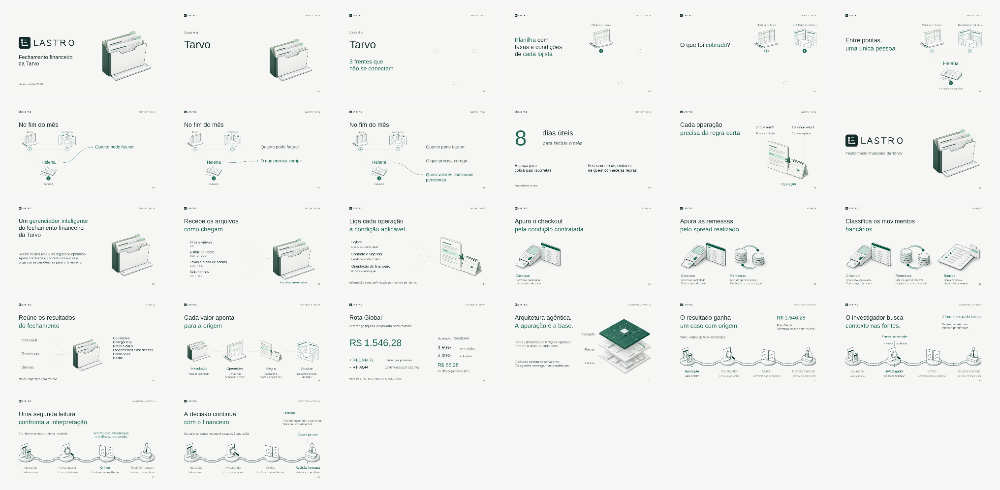

# Slides do pitch Lastro

Versão visual editável com 26 slides, correspondentes aos avanços 0 a 25 do [roteiro](../roteiro.md). O material cobre capa, problema, entrada da solução, apuração e arquitetura agêntica até a decisão humana. A revisão editorial foi aplicada aos 26 avanços, preservando a sequência e as notas de fala. O uso completo na interface e a continuidade entre competências permanecem no roteiro, para uma próxima etapa.

## Sequência

| Avanço | Prévia | Conteúdo |
|---|---|---|
| 0 | [Capa](previews/00.png) | Marca Lastro e fechamento financeiro da Tarvo |
| 1 | [Tarvo](previews/01.png) | Identificação tipográfica provisória do cliente |
| 2 | [Três frentes](previews/02.png) | Posições das fontes ainda sem conexão |
| 3 | [Planilha](previews/03.png) | Taxas e condições de cada lojista |
| 4 | [Relatórios e extratos](previews/04.png) | Cobranças e movimentos registrados |
| 5 | [Helena](previews/05.png) | Triângulo completo, com Helena no centro associada ao marcador 3 |
| 6 | [Quanto pode faturar](previews/06.png) | Junção das informações no fechamento |
| 7 | [O que precisa corrigir](previews/07.png) | Segunda pergunta acrescentada à primeira |
| 8 | [Valores pendentes](previews/08.png) | Terceira pergunta acrescentada às anteriores |
| 9 | [Consequências](previews/09.png) | Oito dias úteis, cobranças incorretas e dependência das regras tácitas |
| 10 | [Regra da operação](previews/10.png) | Contrato, vigência e vínculo do estorno à venda original |
| 11 | [Entrada do Lastro](previews/11.png) | Pausa para apresentar a solução |
| 12 | [Definição](previews/12.png) | Gerenciador inteligente do fechamento financeiro e o trabalho que ele organiza |
| 13 | [Arquivos](previews/13.png) | Orbe e ajustes, Ponte, taxas, contas e bancos |
| 14 | [Cruzamento](previews/14.png) | Operação ligada a lojista, condição aplicável e orientação do financeiro |
| 15 | [Checkout](previews/15.png) | Comissão contratada e comparação das taxas |
| 16 | [Remessas](previews/16.png) | Participação no spread elegível, duplicidades e contestação |
| 17 | [Bancos](previews/17.png) | Conta proposta, justificativa e origem |
| 18 | [Entregas](previews/18.png) | Três frentes convergem para seis saídas |
| 19 | [Rastro](previews/19.png) | Resultado, operações, regra e arquivo de origem |
| 20 | [Rota Global](previews/20.png) | Diferença líquida preparada para revisão e uma operação que a compõe |
| 21 | [Arquitetura agêntica](previews/21.png) | Entrada explícita na investigação assistida, apoiada na apuração |
| 22 | [Pacote do caso](previews/22.png) | Valor, origens, contexto e responsabilidade |
| 23 | [Investigador](previews/23.png) | Consulta às fontes cadastradas por ferramentas de leitura |
| 24 | [Crítico](previews/24.png) | Mesmo pacote, interpretação e evidências recebidas |
| 25 | [Decisão humana](previews/25.png) | Parecer encaminhado ao responsável, com o limite experimental visível |

## Composição

Canvas 1280 × 720, proporção 16:9. Fundo claro e verde vêm dos tokens do Lastro. A tipografia é Arial. A marca Lastro usa os SVGs originais do repositório, com proporção preservada. Textos e conectores são nativos editáveis. Ilustrações raster originais representam as fontes, regras, apuração e arquitetura, com legendas e vínculos editáveis sobrepostos.

Os avanços 21–25 receberam uma nova correção após a rejeição da composição com faixa verde e letras em círculos. A revisão atual aplica fundo claro, títulos regulares, destaque seletivo e ilustrações maiores, a partir dos estudos Barte. A continuidade da explicação observada no Canva permanece no percurso entre apuração, investigador, crítico e revisão humana. A [direção visual](../direcao-visual-canva.md) registra critérios, medidas, prompts e limites. Os avanços 0–20 também receberam essa direção: fontes em triângulo, junção progressiva, definição do Lastro, frentes de apuração e origem dos valores.

Os slides são estados sucessivos da composição. Há um tópico principal por avanço, com destaque no assunto novo. A apuração acrescenta uma frente de cada vez. Na arquitetura, o percurso conserva as quatro estações como contexto e muda o foco e as relações de apoio. Esta versão não configura animação automática entre posições.

**Asset pendente:** a identificação “Tarvo” é texto provisório. Substituir pela logo confirmada, preservando sua posição entre os avanços 1 e 2. Helena aparece pelo nome, sem retrato atribuído a uma pessoa real.

O prazo de oito dias úteis descreve o processo relatado no case. Os valores da Rota Global são uma apuração preparada para revisão; não representam recuperação ou economia já alcançada. As fontes e a fala em bullets acompanham as notas dos slides.

## Relações da arquitetura

- A apuração produz os valores e o rastro que compõem o pacote do caso.
- O investigador recebe o pacote e consulta fontes cadastradas por ferramentas de leitura.
- O crítico recebe o mesmo pacote, a interpretação e as evidências recuperadas. A legenda sobre a estação explicita essas entradas; o crítico não recebe uma conexão de busca às fontes nesta implementação.
- O parecer segue para revisão e decisão de Helena ou Comercial, conforme a responsabilidade do caso. A investigação preserva os valores da apuração.
- O destaque verde indica o tópico atual. O slide final explicita que o parecer é experimental e a decisão financeira cabe ao responsável.

## Evidência financeira e base técnica

O exemplo do slide 20 foi conferido no [pacote Rota atualizado em `b43e80e`](https://github.com/DavidDeodato/Hackathon_barte/blob/b43e80e521646cc46b09e8f2c920fb035c20644d/saida/rota_packet.json), execução `close-2068e24a102ebea3`. Os 87 componentes somam R$ 1.644,72 positivos e R$ 98,44 negativos, resultando em R$ 1.546,28. A operação `TX88423647`, linha 749 do relatório Orbe, contribui com R$ 66,28 e registra taxa contratada de 3,59% e aplicada de 4,09%.

O [commit `b43e80e`](https://github.com/DavidDeodato/Hackathon_barte/commit/b43e80e521646cc46b09e8f2c920fb035c20644d) incorpora os ajustes tardios e publica as saídas atualizadas. A revisão desta apresentação conferiu as fontes publicadas e a soma dos componentes do exemplo; não reexecutou o fechamento financeiro nem uma chamada ao modelo. O slide é uma representação nativa dos dados, sem simular uma captura da interface. As fontes em commit imutável estão nas notas.

A camada de revisão continua experimental. A consulta do código sustenta as responsabilidades desenhadas, sem demonstrar qualidade semântica ou benefício medido do crítico.

## Fonte editável e reprodução

[abertura.mjs](abertura.mjs) exporta o callback `buildOpening`, usado em uma sessão de apresentação já conectada. O código recebe `presentation` e `input`; não cria outro documento. Para gerar a mesma abertura em uma apresentação vazia:

1. Executar o callback com `input.phase = 'cover'` e `input.logoPath` apontando para `web/public/brand/lastro-logo-inverse.svg` no checkout utilizado.
2. Aguardar a conclusão da capa. Executar com `input.phase = 'develop'` e `input.indices = [1, 2, 3, 4]`.
3. Aguardar a conclusão. Executar com `input.phase = 'develop'` e `input.indices = [5, 6, 7, 8, 9]`.
4. Renderizar e conferir os dez slides. Usar a mesma sessão para corrigir o documento existente.

O callback preserva slides que já tenham formas e não os sobrescreve ao repetir um lote. `refineIntro` registra o ajuste aplicado aos slides 1 e 2 da primeira versão, usando os IDs retornados pela inspeção; a construção inicial já inclui essa composição ajustada.

As revisões visuais da abertura foram incorporadas à fonte: destaque em “Planilha” e “cada lojista” no slide 3, pergunta “O que foi cobrado?” no slide 4 e “Entre pontas, uma única pessoa” no slide 5. A fala completa continua nas notas. O documento editável é a referência para preservar edições feitas diretamente no visualizador.

Na revisão da arquitetura também foram espelhadas duas edições manuais do documento: “3 frentes que não se conectam” no avanço 2; no avanço 10, título mais estreito, perguntas “O que tem?” e “De onde veio?” e remoção da observação visual sobre estorno. Essas edições foram preservadas na apresentação e registradas nas fontes/prévias, com aplicação posterior da direção editorial a esses slides.

[solucao-arquitetura.mjs](solucao-arquitetura.mjs) exporta `buildContinuation` para continuar na mesma sessão, depois dos dez slides de abertura. Executar em lotes consecutivos, aguardando cada chamada terminar: `[10, 11, 12, 13, 14]`, `[15, 16, 17, 18]`, `[19, 20, 21]` e `[22, 23, 24, 25]`. Usar `input.indices` para o lote e, no primeiro, `input.logoPath` apontando para `web/public/brand/lastro-logo.svg`. O callback preserva qualquer slide existente e recusa lacunas de numeração. Reparos posteriores usam os IDs inspecionados da mesma apresentação.

[arquitetura-editorial.mjs](arquitetura-editorial.mjs) exporta `reviseEditorialArchitecture`, a correção visual atual dos avanços 21–25. Passar `input.indices` e `input.logoPath` apontando para a marca original do Lastro. Executar em lotes pequenos, aguardando cada conclusão, sempre na sessão existente. O callback valida IDs e preserva os demais slides e suas notas. Imagens externas a esta revisão interrompem a substituição para reinspeção. Os IDs são específicos desse documento; adaptar a validação somente depois de inspecionar outro deck.

Os PNGs originais estão em `assets/`, com [prompts completos](assets/prompts-v3.json). Na sessão, os PNGs são incorporados diretamente com `dataUrl` e `contentType: image/png`. As ilustrações não usam SVG intermediário nem referências a arquivos locais. A marca permanece no SVG original. A verificação reabre o documento e renderiza os 26 slides para conferir a disponibilidade dos assets; isso não equivale a uma inspeção da interface do usuário. Os objetos textuais continuam editáveis.

[arquitetura-cenas.mjs](arquitetura-cenas.mjs) registra a amostra anterior, rejeitada e substituída. Não deve ser usado para restaurar o visual atual.

As imagens em `previews/` são capturas renderizadas da apresentação editável. Servem à revisão visual no repositório e precisam ser atualizadas quando o documento mudar.

## Apresentação completa no repositório

[Lastro_pitch.pptx](../Lastro_pitch.pptx) contém os 26 slides desta versão de desenvolvimento, da capa até a decisão humana. Textos e relações permanecem editáveis; ilustrações são raster. As prévias individuais acompanham esta exportação.

[deck-editorial.mjs](deck-editorial.mjs) exporta `reviseFullEditorialDeck` para os avanços 0–20 da sessão existente. Recebe `input.indices` e `input.logoPath`, valida os IDs e preserva os demais slides e notas. Executar em lotes pequenos, inspecionando o documento antes de substituir elementos. A arquitetura 21–25 permanece em `arquitetura-editorial.mjs`. Os novos assets e prompts estão em [assets/prompts-deck-completo.json](assets/prompts-deck-completo.json).
